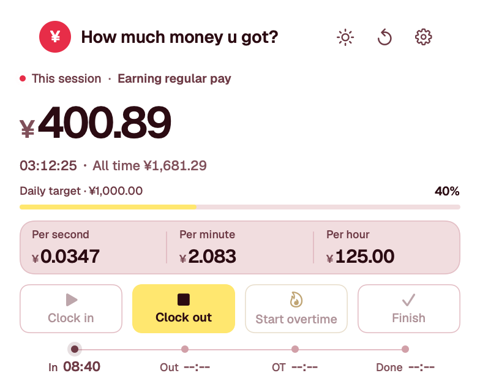
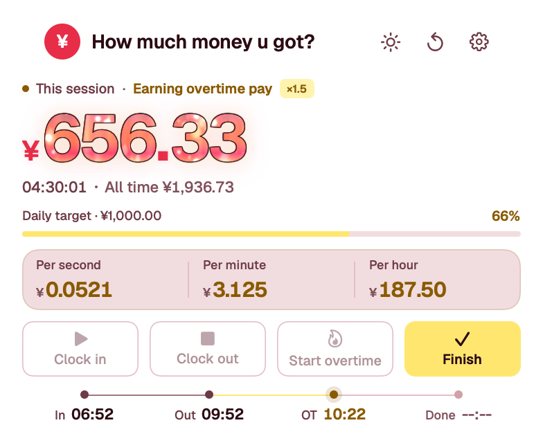
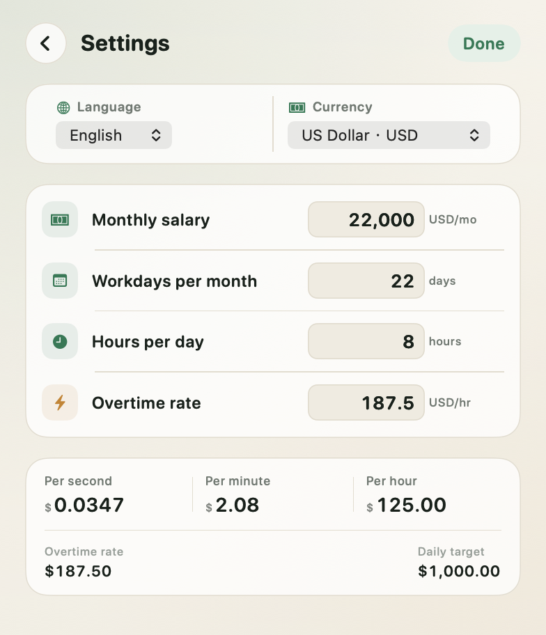

  

<h1 align="center">How much money u got?</h1>

<strong>A quiet little earnings ticker for macOS and Windows.</strong>

  <a href="https://github.com/fawkesjiran-cell/howmuchmoneyugot/releases">Download the latest release</a>
  ·
  <a href="README.md">简体中文</a>

## Features

- **Live earnings** — clock in and watch the amount grow by the second.
- **Normal and overtime pay** — separate rates, with overtime calculated at your own multiplier.
- **A complete workday** — clock in, clock out, start overtime, and finish in one compact panel.
- **Fire in the numbers** — overtime digits burn with a living flame without covering the card.
- **All-time total** — completed sessions stay in the ledger, so the menu bar total never drops.
- **Safe reset** — reset the current session or clear everything, always with confirmation.
- **Menu bar / system tray** — open the panel from the tray and see the running total at a glance.
- **Two languages** — English and Simplified Chinese switch instantly.
- **Eight currencies** — CNY, USD, EUR, GBP, JPY, HKD, KRW, and SGD, with display symbols only.
- **How many Big Macs u got?** — optional; turn this session's earnings into burgers scattered beside the amount (up to 200 at once), with the exact count on hover.
- **Light, dark, or system** — one compact button cycles through all three and remembers your choice.
- **Built to last** — timestamps survive sleep and restarts; no interval drift.
- **Controlled GitHub updates** — update-enabled builds can check and install releases from the matching GitHub Release without telemetry.
- **Local-first** — settings and earnings stay on your computer; offline builds never use the network.

| Overtime | Settings |
| --- | --- |
|  |  |

## Choose a build

| Build | Platform | Updates | Network |
| --- | --- | --- | --- |
| **macOS Swift (Updater)** | macOS 13+ | In-app check / automatic install | Update requests only |
| **macOS Swift (Offline)** | macOS 13+ | No updater | No network at all |
| **Windows Electron (Updater)** | Windows 10/11 | In-app check / automatic install | Update requests only |
| **Windows Electron (Offline)** | Windows 10/11 | No updater | No network at all |

- Updater builds contact GitHub Releases only when an automatic or manual check runs. There is no telemetry, analytics, advertising, or other background transfer.
- When a newer version is found, the top-left home icon becomes an update button; the Updates section sits above Reset everything in Settings.
- Offline builds contain no updater and block HTTP / HTTPS / WebSocket requests, so they do not send or receive any external data.
- Update checks are off by default.

## Available for

| Platform | Build |
| --- | --- |
| macOS 13+ | Native Swift (Updater / Offline) |
| Windows 10/11 | Electron (Updater / Offline) |

All four builds are available from the
[Releases](https://github.com/fawkesjiran-cell/howmuchmoneyugot/releases) page.

macOS Updater: `How-Much-Money-U-Got-<version>-macOS-Swift.zip`
macOS Offline: `How-Much-Money-U-Got-<version>-macOS-Offline.zip`
Windows Updater: `How-Much-Money-U-Got-Setup-<version>.exe`
Windows Offline: `How-Much-Money-U-Got-Offline-Setup-<version>.exe`

> On Windows, automatic updates are provided by the Setup installer. Portable exe and zip builds are suited to manual updates.

## Tech stack

- **Native macOS** — Swift, SwiftUI, AppKit
- **Windows** — Electron, JavaScript, HTML/CSS
- **Overtime motion** — Vortex on Swift, Canvas on Electron

## Credits

- Created by [fawkesjiran-cell](https://github.com/fawkesjiran-cell).
- **Geist** typeface by [Vercel](https://github.com/vercel/geist-font), licensed under the SIL Open Font License 1.1.
- **Vortex** particle system by [Paul Hudson](https://github.com/twostraws/Vortex), licensed under the MIT License.
- App icon artwork created for this project.
- Windows builds use [Electron](https://www.electronjs.org) and Chromium; their licenses apply to those builds.

See [THIRD_PARTY_NOTICES.md](THIRD_PARTY_NOTICES.md) for full third-party license text.

## License

[MIT](LICENSE) © 2026 fawkesjiran-cell
