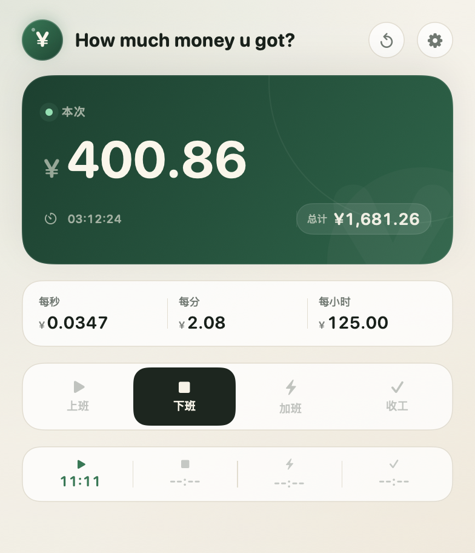
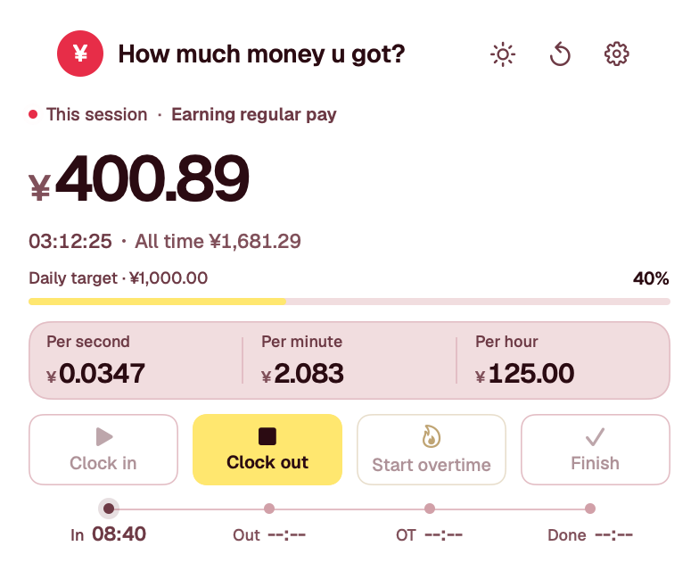
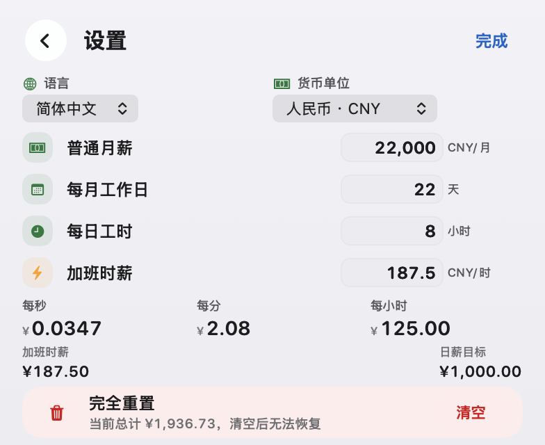
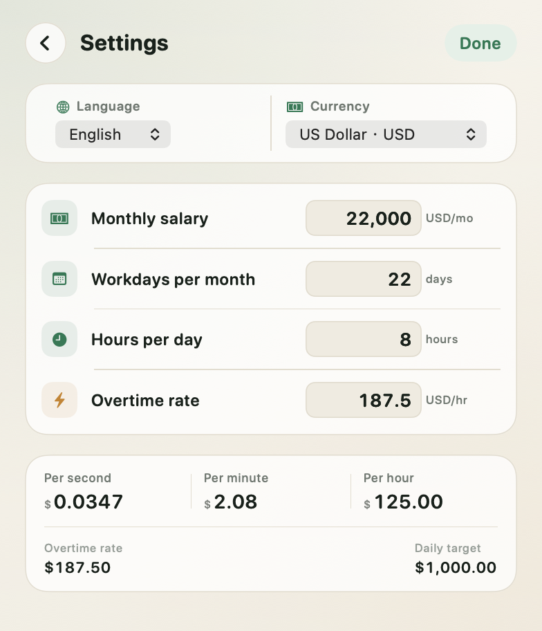
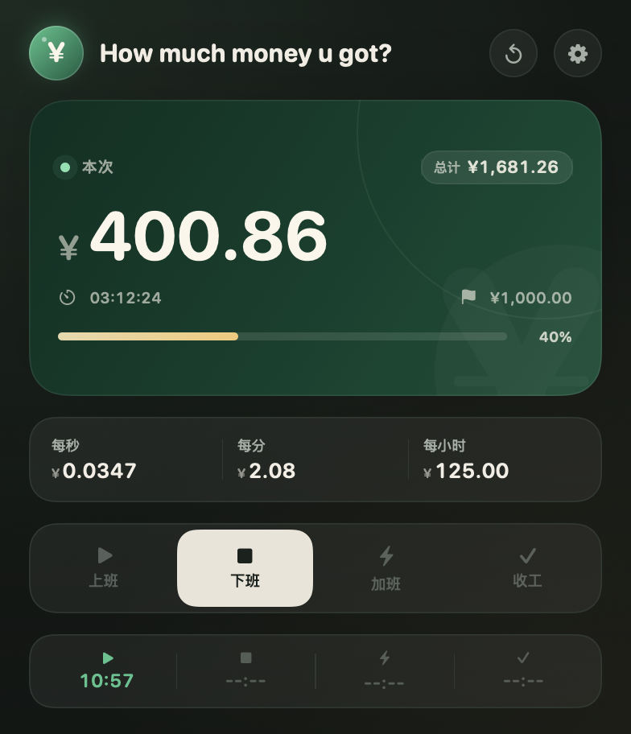
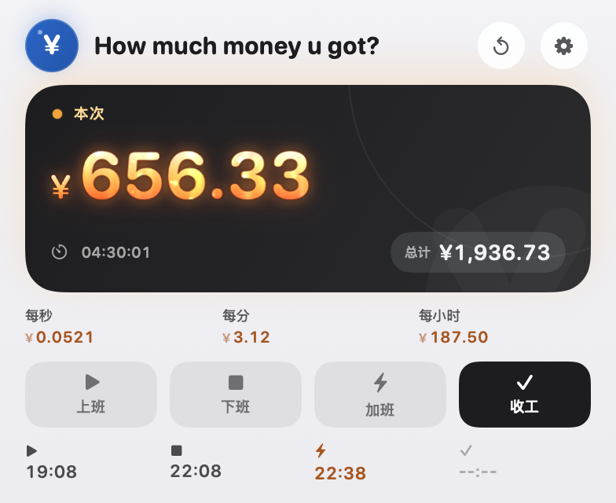
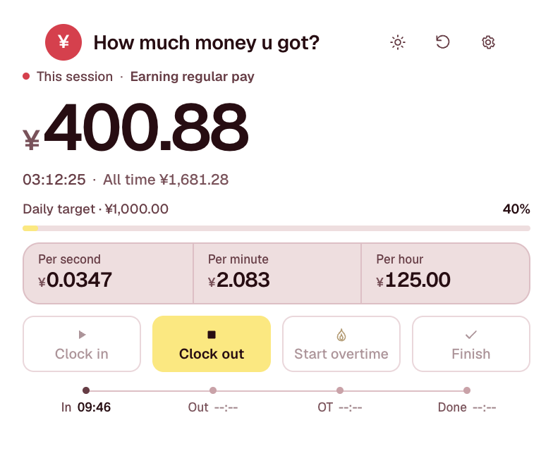
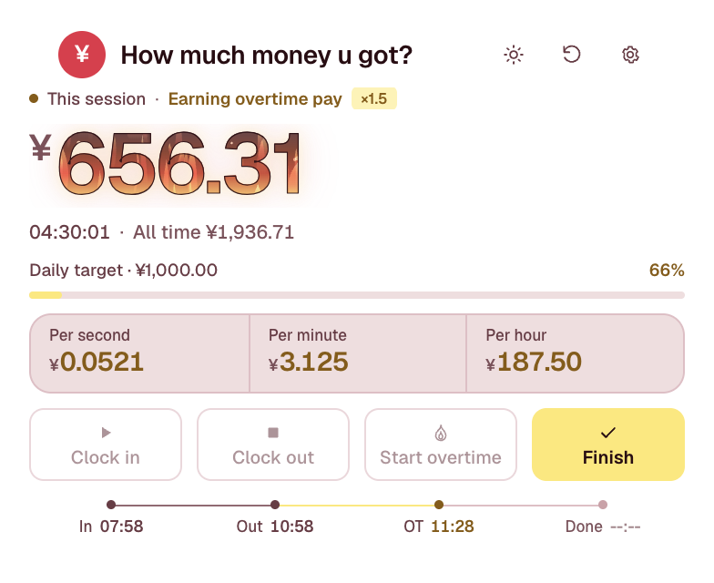

# How much money u got?

一个常驻 macOS 菜单栏的实时工资计薪小工具。应用名固定为 **How much money u got?**，不随语言切换；界面支持简体中文 / English，以及多种货币单位显示。




## 功能

- **收入换算**：填写普通月薪、每月工作日、每日工时、加班时薪，自动换算成每秒 / 每分钟 / 每小时收入。
- **实时累计**：正常上班与加班分别累计，金额精确到分，费率随当前处于正常或加班状态自动切换。
- **加班火焰特效**：进入加班模式后，本次金额的数字本身就在燃烧——白热的核心、流动的火舌与余烬都长在字形里，数字下方不放火，整体轻微脉动；普通上班状态保持干净的数字样式。
- **记录不丢失**：下班或收工后再次上班，上一次收入会自动归入“总计”；本次从零重新累计，但总计和菜单栏金额不会回落。
- **完全重置**：设置页底部的「完全重置」会在二次确认后清空总计与本次累计，并停止当前计时；薪资、语言、货币与外观设置保持不变。
- **完整打卡流程**：紧凑操作条中的上班、下班、加班、收工四个动作，覆盖一天的工作节奏。
- **菜单栏小组件**：右上角常驻显示持久化的累计总计，图标与符号跟随货币切换；左键打开面板，右键可快速重置本次或退出。
- **双语界面**：简体中文 / English 即时切换，面板、菜单栏提示、右键菜单、系统菜单与弹窗同步更新；应用名始终保持 **How much money u got?**。
- **可选货币单位**：人民币、美元、欧元、英镑、日元、港币、韩元、新加坡元；切换只改变显示符号，不换算已填写的金额。
- **状态自动恢复**：所有计时都基于真实时间戳，Mac 睡眠、退出应用后重新打开都会继续正确累计。
- **本机存储**：设置、语言、货币与计时记录只保存在本机 `UserDefaults`，不上传任何数据。
- **外观切换**：主界面右上角一个按钮循环切换「跟随系统 / 亮色 / 暗色」，不额外占用一行；点击后短暂提示当前模式，选择会持久化。

| 中文 | English |
| --- | --- |
|  |  |
|  |  |

深色模式：



加班火焰模式：



## 安装与运行

要求：macOS 13 或更高版本；只需安装 Xcode Command Line Tools。粒子效果使用项目内置的 MIT 开源库 Vortex，构建无需联网。

```bash
git clone https://github.com/fawkesjiran-cell/howmuchmoneyugot.git
cd howmuchmoneyugot
./Scripts/build_app.sh
open "dist/How much money u got?.app"
```

构建产物在 `dist/How much money u got?.app`。首次打开会自动弹出计薪面板；之后点击菜单栏右上角的金额小组件即可打开。

也可以直接用于开发调试：

```bash
swift run HowMuch
```

应用采用 ad-hoc 签名，未经过 Apple 公证。如果从网络下载后被 Gatekeeper 拦截，请在 Finder 中右键应用并选择“打开”。

## 使用

1. 点击面板右上角的齿轮，选择语言、货币单位，并填写月薪、每月工作日、每日工时和加班时薪。
2. 点击操作条中的 **上班**，本次金额开始实时累计；面板右下角和菜单栏同时显示累计总计。
3. 下班时点击 **下班**；如果需要加班，再点击 **加班**，加班时薪会立即生效。
4. 加班结束点击 **收工**，本次计薪完成并保留结果。
5. 再次点击 **上班** 会保留上一次收入并开启新的“本次”；第一段收入已经计入总计，菜单栏数字不会归零。右上角重置图标只清空本次，历史总计不受影响。

如果要从头开始，打开设置页底部的「完全重置」：二次确认后总计与本次金额一起清零，并停止当前计时；薪资、语言、货币与外观设置会保留。

切换货币只会更新金额前的符号（例如 `¥` → `$`），不会自动换算数字。右击菜单栏图标可以直接打开面板、重置本次计薪或退出应用。

## 计算方式

```text
普通时薪 = 普通月薪 ÷ (每月工作日 × 每日工时)
每秒收入 = 时薪 ÷ 3600
每分钟收入 = 时薪 ÷ 60
每小时收入 = 时薪

本次累计 = 正常工时 × 普通每秒收入 + 加班工时 × 加班每秒收入
```

加班时薪独立于普通时薪保存。右击设置页中的加班时薪行，可按普通时薪的 1.5 倍填入。

计时金额由开始/结束时间戳推导，不依赖定时器累加，因此应用重启、电脑休眠或系统时间短暂卡顿都不会丢失时长。

## 项目结构

```text
Sources/
  HowMuchCore/    纯计算模型、状态机、收入快照
  HowMuchApp/     SwiftUI 界面、AppKit 菜单栏组件、双语本地化、持久化
 electron/         Electron 跨平台版（macOS / Windows）、托盘、渲染器和发布配置
Tests/
  CoreChecks/     无 XCTest 依赖的核心逻辑检查
Resources/        Info.plist、应用图标
Scripts/          图标生成、打包、核心检查
Vendor/Vortex/    本地内置的 MIT 开源 SwiftUI 粒子引擎
```

## 第三方

加班火焰由 [Vortex](https://github.com/twostraws/Vortex) 驱动，MIT License，版权归 Paul Hudson 所有。项目内已内置对应源码与许可证说明，构建不依赖网络；完整许可见 [THIRD_PARTY_NOTICES.md](THIRD_PARTY_NOTICES.md)。

## 跨平台 Electron 版（macOS / Windows）

仓库里的 `electron/` 是同一套界面与计薪逻辑的 Electron 实现，支持 macOS 和 Windows（Node.js 22.12+）：

```bash
cd electron
npm install
npm start

# 本机打包
npm run pack:mac   # macOS arm64 + x64，输出 electron/release
npm run pack:win   # Windows x64，输出 electron/release

# 核心/持久化逻辑测试
npm test
```

- 面板固定 392×320，支持托盘弹出、跟随系统/亮色/暗色切换、双语、货币、计薪与重置。
- macOS 本机打包可产出 `.dmg` / `.zip`；GitHub Release 使用 `.zip`（arm64、x64，避免 CI 对 dmg 工具的依赖）。Windows 产物为 `.exe` 安装包 / `.zip`（x64）。
- 打包名使用 `How Much Money U Got`（Windows 文件名不能包含 `?`），应用内仍显示 **How much money u got?**。
- 当前还没有 Apple Developer ID / Windows 代码签名证书，下载后可能出现 Gatekeeper 或 SmartScreen 提示。
- 发布由 GitHub Actions 自动完成：更新 `electron/package.json` 的版本，打 `v` 前缀 tag 并推送，macOS 与 Windows 构建完成后会创建 GitHub Release。

```bash
git tag v1.5.0
git push origin v1.5.0
```





## 开发

```bash
# 构建调试版本
swift build

# 运行核心逻辑检查
./Scripts/check.sh

# 生成图标
python3 Scripts/make_icon.py   # 使用 macOS sips + iconutil

# 构建并签名 .app
./Scripts/build_app.sh
```

## 数据

- 设置项、语言、货币单位、本次计时状态与历史总计保存在本机 `UserDefaults`。
- 应用没有网络权限，也没有任何统计或上报代码。
- 重置本次计薪只清除当前“本次”金额，历史总计保留。

## License

[MIT](LICENSE) © 2026 fawkesjiran-cell
