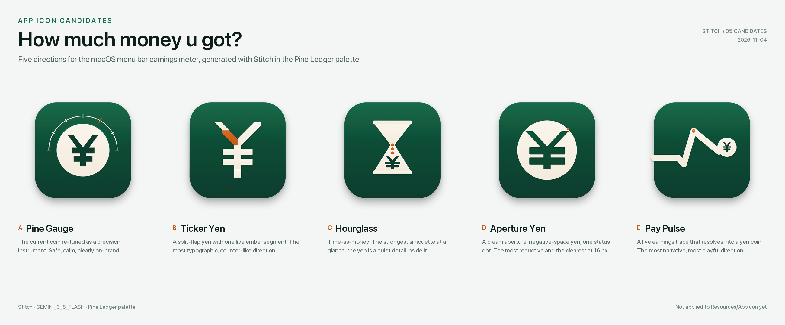
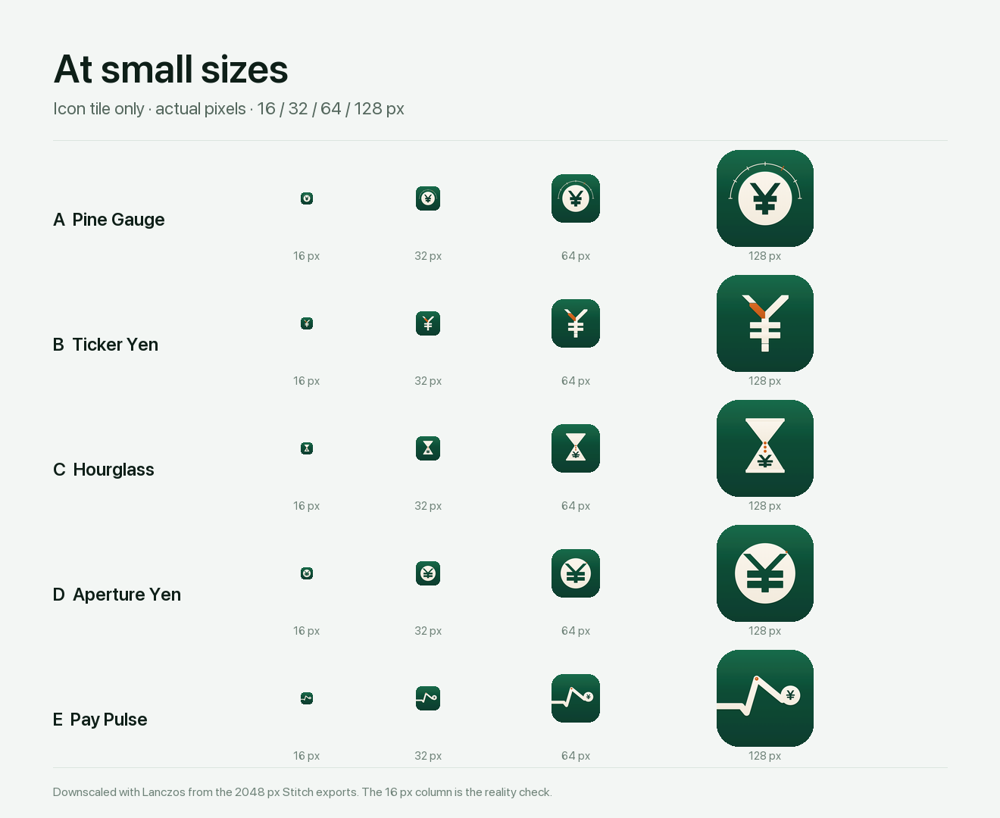

# App icon candidates · 2026-11-04

为 **How much money u got?** 准备的 5 个应用图标方向。全部由 Stitch 生成，沿用 Pine Ledger 的松绿、奶油和余烬橙；尚未替换 `Resources/AppIcon`。

## 五个方向

| # | 名称 | 概念 | 小尺寸判断 |
| --- | --- | --- | --- |
| A | [**Pine Gauge**](01-pine-gauge.png) | 现有金币图标的进化：奶油表盘、深松绿 ¥，外圈加半圈刻度和一个余烬橙目标刻度。 | 32 px 起清楚；16 px 只剩金币和 ¥，弧线消失。 |
| B | [**Ticker Yen**](02-ticker-yen.png) | 分瓣翻牌式 ¥，左臂一段余烬橙，像实时的数字计数器。 | 16 px 仍能读出 ¥，是五个里最有性格的字体方向。 |
| C | [**Hourglass**](03-hourglass.png) | 奶油沙漏，下半部挖出 ¥，三粒余烬橙从腰部落下。 | 沙漏剪影最强；16 px 时 ¥ 变成一个小点，“钱”的读法变弱。 |
| D | [**Aperture Yen**](04-aperture-yen.png) | 一个大奶油圆孔，负空间 ¥，右上角一个余烬橙状态点。 | 16 px 最清楚，最像一个可缩放的完成品 logo。 |
| E | [**Pay Pulse**](05-pay-pulse.png) | 一条粗奶油心跳线从左进入，接住右侧的 ¥ 硬币，峰值一点余烬橙。 | 128 px 很有叙事性；16 px 更像一条折线，钱的含义最弱。 |

## 怎么选

- **想要一个新 logo：D · Aperture Yen。** 形最少、缩得最小、在 Finder 列表和 Dock 里都成立；也是五个里最像独立 logo、最少装饰的那个。
- **想保留现有识别：A · Pine Gauge。** 还是金币 + ¥，但把装饰性的星星和轨道换成了仪表刻度，最稳的升级。
- **想要性格：B · Ticker Yen。** 翻牌计数器的暗示和实时累计的产品逻辑最贴。落地前建议手工收一遍 ¥ 的横杠和竖笔接缝。
- **想要故事：C 或 E。** 沙漏讲“时间就是钱”，心跳线讲“钱在实时长出来”；两者都更适合作为品牌插画或第二轮探索，而不是最终 app icon。

我的排序：**D > A > B > C > E**。如果只选一个，选 D；如果这次不想让老用户觉得换了个 app，选 A。

## 视觉规则

| Token | Hex | 用途 |
| --- | --- | --- |
| pine | `#0F3D2E` / `#146B4A` | tile 主体，上浅下深 |
| cream | `#F3EBDD` | 硬币、沙漏、线条、主字形 |
| ember | `#C25A17` | 只做 live / overtime 信号，不做装饰 |
| canvas | `#F3F6F4` | 展示图背景 |

- macOS Big Sur 圆角方形，1024 画板里 tile 为 758 × 758，圆角 172；2048 PNG 为 2× 展示图。
- 只允许 ¥ 一个字形；没有文字、没有星星、没有玻璃拟态、没有渐变字。
- 5 个方向共用同一光源、同一 tile 比例、同一层接触阴影，方便横向比较。
- 所有方向都保留 ¥，和现在的图标、应用默认的中文语境一致。如果以后想弱化单一货币，可以做一版无币种的 coin 标记；代价是 16 px 下“钱”的识别度会下降。
- 小尺寸真实像素对比见 [small-sizes.png](small-sizes.png)：

## Stitch 记录

- 项目：[How much money u got? — App Icon Candidates 2026-11-04](https://stitch.withgoogle.com/projects/15073270735791219942)
- 模型：`GEMINI_3_8_FLASH`，`AGNOSTIC`，每个候选一个 screen。
- Screen ID：
  - A `projects/15073270735791219942/screens/51c625dd503544bf93ef421c75d4cd10`
  - B `projects/15073270735791219942/screens/afd37a697b0b483d86e3afe2e6bfbefb`
  - C `projects/15073270735791219942/screens/d7318e195e6f42228c6c6583426fd55e`
  - D `projects/15073270735791219942/screens/e7a62b9cc89149dc95afe3e4d8f0c5e7`
  - E `projects/15073270735791219942/screens/d2e980b93578477e81e8c3dd967f8a70`

> Stitch MCP 的 `list_screens` 目前对这些生成仍返回空，这是平台的 screen 索引同步问题，不是本地 mock。上面的图是从生成结果里的 screen / file ID 直接下载的；项目网页在已登录浏览器里打开后，通常才会触发索引同步。生成 prompt、screen ID 和 file ID 都记录在 `meta/*.json`。

## 文件

| 路径 | 内容 |
| --- | --- |
| `01-pine-gauge.png` … `05-pay-pulse.png` | 2048 × 2048 Stitch 展示图（含 tile 阴影与背景） |
| `svg/*.svg` | 1024 × 1024 矢量画板；同样含背景和 tile 阴影，不是透明 glyph |
| `meta/*.json` | prompt、screen ID、file ID、生成时间 |
| `overview.png` | 五图标总览，2600 × 1080 |
| `small-sizes.png` | 16 / 32 / 64 / 128 px 实际像素对比 |

## 下一步

选中一个方向后，可以继续做：

1. 手工修一遍 ¥ 的字形几何（横杠居中、竖笔接缝、16 px 对齐）。
2. 去掉展示背景和 tile 阴影，按 Apple 的 824 × 824 图标网格重排。
3. 生成 `AppIcon.iconset` + `.icns`，替换 `Resources/AppIcon`，跑 `./Scripts/build_app.sh` 验证 Finder / Dock / 菜单栏实际显示。

当前没有改 `Resources/AppIcon`、`Package.swift` 或任何 Swift 源码。
