# Reicon 图标替换评估 · Before / After

**日期** 2026-11-08 · **范围** Electron renderer + macOS SwiftUI · **状态** 已落地 v1.6.0（评估阶段的 Before/After 对比保留在本文；真实运行截图见第 11 节）

> 本文的 After 图是**替换前的静态对比稿**，不是 v1.6.0 的构建截图；v1.6.0 已按这套方案落进 macOS SwiftUI 和 Electron renderer，真实运行截图见第 11 节。评估阶段没有改应用源码，落地后的改动文件见第 11 节。
>
> 对比稿使用当时 renderer 的真实 HTML/CSS 做静态快照：`panel-before.html`（原 sprite / 原尺寸）和 `panel-after.html`（Reicon + 新尺寸），同一组演示数据，Chrome 以 2× 截图。截图前已禁用 CSS transition / animation，避免截到动画中间帧。

## 结论

1. **当前图标没有功能性故障**。整体是克制的线面混合体系，尺寸、颜色、位置都在一套 token 里；暗色和亮色都成立。
2. 最弱的一处是主界面 4 个操作图标：`Clock in` / `Clock out` 是实心，`Start overtime` / `Finish` 是细线。12px 下 `flame` 已经像一个水滴，`checkmark` 也偏轻，导致两个“更少点”的动作看起来像次要或禁用状态。
3. **Reicon 适合做统一来源**（MIT、24×24 网格、Outline / Filled 双权重、2,700+ 图标），但**不能只换 SVG**：Reicon Outline 是 1.5px / 24，在现有 11–13px 显示尺寸下比当前 1.6–2.0px 的 sprite 更细。方案必须同时放大 1–2px，并把 4 个操作图标改成 Filled。
4. **建议分两步**：先做 Electron（改动集中在一个 sprite + 几条 CSS，容易截图验证）；SwiftUI 是否跟进取决于是否要求双端几何一致。无论是否换 Reicon，先修 `focus-visible` 和硬编码英文 aria 这两个 a11y 问题（Electron 图标按钮本来就有运行时 `title`）。
5. **不替换**：🍔 emoji（Reicon 没有汉堡，且这是功能的一部分）、货币符号 logo（8 种货币，Reicon 只有 dollar）、app icon（见 `docs/redesign/icon-candidates/`）。

**推荐：Option A（Electron 全量 + a11y 修复）**。把 Option B（双端全量）留到确认 macOS 端也想要同一套几何之后。

---

## 0. 方法与边界

- 读 `electron/src/renderer/{index.html,styles.css,renderer.js}` 和 `Sources/HowMuchApp/*.swift`，逐项列出图标、尺寸、权重、颜色、使用位置。
- 用 Reicon MCP 的 `search_icons` / `view_icon` 选型；抽查的原始 SVG path 与 npm `reicon@1.2.5` 一致。
- 用当前 renderer 的 HTML/CSS 做静态快照：同一组演示数据（`¥400.89 / 03:12:25 / 40% / 08:40`），Chrome `--force-device-scale-factor=2`，输出 784×640。
- 像素 diff 统计通道差 >10 的像素；截图前设置 `transition: none !important; animation: none !important`。
- **评估阶段未做**：评审时没有把新图标接进运行态；v1.6.0 落地后的真实截图见第 11 节。1× Windows 物理屏、macOS 13 实机、真实读屏器仍未验证（边界见第 9 节）。

---

## 1. Before：现在是什么

### 1.1 两套图标，18 个语义

| 端 | 来源 | 数量 | 渲染尺寸 | 权重 |
| --- | --- | --- | --- | --- |
| Windows Electron | `index.html` 内联 `<symbol>` sprite，24×24 viewBox | 18 | 11–14 px | 以 stroke 为主（1.6 / 1.7 / 2.0），3 个 filled（play / stop / bolt）；system 是 stroke + fill 混合 |
| macOS SwiftUI | SF Symbols，`Image(systemName:)` | 18 | 10–14 pt | fill / outline 混用（`play.fill`、`stop.fill`、`flame`、`checkmark` 等） |

两端共享同一套 Signal Ledger token：亮色 canvas `#FFFFFF`、surface `#F1DDDF`、ink `#2B0B12`；暗色 canvas `#1C1416`、surface `#2A2022`、ink `#F8F1F2`。主色 `#E72D48`（暗色 `#FF6579`），加班 ember `#FFE76F`，危险色 `#B3122C`。

### 1.2 现有图标的使用位置

| 用途 | Electron | SwiftUI | 尺寸 |
| --- | --- | --- | --- |
| Theme · System / Light / Dark | `i-system` / `i-sun` / `i-moon` | `circle.lefthalf.filled` / `sun.max` / `moon` | 13 px / 13 pt |
| Reset session | `i-reset` | `arrow.counterclockwise` | 13 |
| Check updates | `i-refresh` | `arrow.triangle.2.circlepath` | 11 / 10.5 |
| Download / install | `i-download` | `arrow.down.circle`（行）；更新提示用 `arrow.down` | 11 / 10.5（row）；prompt 12 / 11 |
| Settings | `i-gear` | `gearshape` | 13 |
| Clock in / Clock out | `i-play` / `i-stop` | `play.fill` / `stop.fill` | 12 |
| Start overtime / Finish | `i-flame` / `i-check` | `flame` / `checkmark` | 12 |
| Back | `i-left` | `chevron.left` | 14 |
| Select chevron | `i-down` | `chevron.down` | 11 |
| Monthly salary | `i-bank` | `banknote` | 12 |
| Workdays / Hours | `i-calendar` / `i-clock` | `calendar` / `clock` | 12 |
| Overtime rate | `i-bolt` | `bolt` | 12 |
| Reset everything | `i-trash` | `trash` | 12 / 10 |

### 1.3 不是图标、但容易被误认为图标的东西

| 元素 | 处理 | 原因 |
| --- | --- | --- |
| 左上角 `¥ / $ / € …` logo | **保留文字货币符号** | 跟随 8 种货币切换；Reicon 只有 `dollar`，没有完整货币集 |
| 🍔 Big Mac 行 / 散落汉堡 | **保留 emoji** | Reicon 没有汉堡；散落汉堡是产品趣味的一部分，改成单色线稿会丢失识别 |
| 状态点（5px 圆） | 保留 | 是状态语义，不是图标 |
| 开关（switch） | 保留 | 自绘控件，不是图标 |
| 加班火焰数字 | 保留 Canvas | 是逐帧绘制的数字效果，不是静态图标 |
| 菜单栏 / tray 图标 | 保留货币符号 template image | `StatusBarController.swift:377` 用货币符号生成 template image，会随货币切换；不属于 SF Symbols / Reicon |

### 1.4 做得好的地方

- **对比度**：`--muted` / `--faint` 在亮暗两套 token 下都超过 4.5:1（项目文档记录：亮色 5.5 / 4.6，暗色 8.5 / 5.1；本次未重新测量），图标作为非文本控件超过 3:1 的要求。
- **图标按钮有 aria-label 和 title**：主题、重置、设置、返回、更新提示等都在运行时从 i18n 取标签，并已有 `title` tooltip（`renderer.js:97, 543–563, 590–599`）。
- **减少动效**：火焰和状态点在 `prefers-reduced-motion` / `accessibilityReduceMotion` 下都有降级。
- **离线 / CSP 友好**：`index.html:6` 的 CSP 是 `default-src 'self'`，离线版还阻断网络。图标必须内联或随包，不能用 CDN。这一点直接排除了 Reicon 的 `<re-icon>` Web Component 和 CDN 方案。

---

## 2. Findings

按严重度排序。Severity 只针对视觉 / 可访问性，不影响计薪逻辑。

### F1 · 操作行四个图标的视觉权重不一致（Medium）

- **位置**：`electron/src/renderer/index.html:20–23, 104–113`、`electron/src/renderer/styles.css:552`；SwiftUI `Sources/HowMuchApp/DashboardView.swift:397, 406, 415, 425`。
- **证据**：Electron 的 `play`、`stop` 是 filled，`flame`、`check` 是 stroke；SwiftUI 同样是 `play.fill` / `stop.fill` 对 `flame` / `checkmark`。在 2× 截图里，12px 的 flame 只剩一个细水滴，check 是一根发丝；而 Clock out 的方块很重。
- **影响**：`Start overtime` / `Finish` 的图标在启用时也像 disabled / 次要；四个按钮里 Clock out 的方块最重，Start overtime 的水滴和 Finish 的细线最轻，视觉强度没有跟随“当前可用的主操作”。12px 下这是可读性问题，不只是风格问题。
- **建议**：四个操作图标统一用 Filled，尺寸 12→14；14px SVG 加 `margin: -1px 0`，让 flex 布局高度仍是 12px，文字基线完全不动。SwiftUI 对应 `flame.fill`，check 提到 `.bold` 权重，或统一用 Reicon Filled。
- **置信度**：高（已渲染对比）。

### F2 · 11–13px 的 24 网格线图标在 1× 屏上落到亚像素（Medium）

- **位置**：`styles.css:224, 552, 672, 791, 933, 975, 1049`；sprite 的 stroke 在 `index.html:13–30`。
- **计算**：当前 1.7px / 24 × 13px = **0.92px**；1.6 / 24 × 12 = **0.80px**；2.0 / 24 × 14 = **1.17px**。Reicon 1.5 / 24 × 13 = **0.81px**，比现在更细。Windows 100% / 125% 缩放下，低于 1px 的描边会被抗锯齿摊成灰色。
- **影响**：Electron 是 Windows 版本；这正是当前 sprite 最吃亏的场景。Retina / 2× 下不明显，1× 下 chrome 会发虚。
- **建议**：不能只换 path。按第 4 节的尺寸表放大 1–2px；12px 操作图标改 Filled；如果 1× 是主要目标，header 可以再考虑 15–16px（本次 mock 用 14，见 4.2 的取舍）。
- **置信度**：数学高；实际 1× 物理屏未验证（见第 9 节）。

### F3 · 双端没有共同图标来源，已经出现语义漂移（Medium / Low）

- **位置**：Electron sprite `index.html:13–30`；SwiftUI 18 个 SF Symbol 名称散落在 `DashboardView.swift` / `SettingsView.swift`。
- **证据**：
  - gear：Electron 是 6 齿线稿，SwiftUI 是 `gearshape`；
  - 薪资：Electron 是 banknote 矩形，SwiftUI 是 `banknote`；
  - reset：Electron 是圆环箭头，SwiftUI 是 `arrow.counterclockwise`；
  - 自动安装：Electron 用 `i-download`，SwiftUI 用 `arrow.down.circle`；
  - 更新提示：Electron 用 `i-download`，SwiftUI 用 `arrow.down`。
- **影响**：同一产品在两个平台的图标不是同一套几何；一次改图标要改两处；市场截图和文档不能完全复用；用户切换平台时会感到细微不一致。
- **建议**：接受平台原生（保留现状）或选一套共同几何（Reicon）。如果选 Reicon，务必同时定义 manifest，避免两端各抄一份。
- **置信度**：高（代码逐项对照）。

### F4 · 🍔 是设置页唯一的彩色字形（Low）

- **位置**：`index.html:173`、`renderer.js:184`、`Sources/HowMuchApp/SettingsView.swift:164`、`BigMacScatter.swift:310`。
- **证据**：设置页的 Preferences / Pay / Updates / Data 图标全是单色线稿，只有 Big Mac 行是彩色 emoji；散落汉堡最多 200 个，也是 emoji。Apple / Segoe UI Emoji 的渲染不同，不能 tint，不能随主题换色。
- **影响**：视觉上是一个故意的“彩蛋”，但也确实破坏了图标的单色规则；跨平台观感不一致。不是 a11y 问题：设置行 emoji 有 `aria-hidden`，散落汉堡有 `role="img"` / 计数文案。
- **建议**：散落汉堡保留 emoji（这是功能魅力）；设置行如果想更克制，可以换成自制单色汉堡 mark，或保留 emoji 但在周围用更中性的底色。Reicon 的 `food-tray` / `plate` 都不像 Big Mac，不建议硬换。
- **置信度**：高。

### F5 · 部分 ARIA 标签硬编码英文（Low / Medium）

- **位置**：`index.html:70, 87, 102, 117, 159, 166`；运行时只更新了部分标签（`renderer.js:97, 552–563, 590–593`）。
- **证据**：`aria-label="Current rates"`、`"Time clock"`、`"Session timeline"`、`"Language"`、`"Currency"`、`"Overtime earnings on fire"` 都没有走 i18n。中文界面下，屏幕阅读器会在中文里读到这些英文；四个 action 的 `<svg>` 也没有 `aria-hidden`（头部更新按钮有）。
- **影响**：中英混读；装饰性 SVG 可能被某些读屏器当作未命名图形暴露。
- **建议**：把这些 label 加进 `i18n.js`（zh-Hans / en）；所有装饰性图标统一 `aria-hidden="true" focusable="false"`；canvas 只保留有意义的 `aria-label` 或改成 `role="img"`。
- **置信度**：高（代码检查；未做真实读屏器测试）。

### F6 · Focus ring 不一致（Low）

- **位置**：`styles.css:164, 859, 899, 932, 1004` 只有这几处 `:focus-visible` / `:focus`；`.iconbtn`、`.action`、`.backbtn`、`.done`、`.clear-btn` 没有自定义焦点样式。
- **影响**：键盘用户看到的是浏览器默认 outline，形状和圆角按钮不一致；但默认 outline 没有被移除，所以不是“完全不可见”的阻断问题。
- **建议**：加一条共享的 `:focus-visible { outline: 1.5px solid var(--primary); outline-offset: 2px; }`，覆盖上述控件；暗色下用 `--primary` 即可。
- **置信度**：中（未做真机键盘走查）。

### 另外记录，不计为 finding

- 28×28 px 的 header / back 命中区域偏小（Windows 桌面可接受，触屏不友好）。这是桌面面板，暂不列为问题。
- “加班”有两个隐喻：操作行用 flame，薪资行用 bolt。bolt 是“费率/能量”的强调色，语义上说得通；如果以后想更统一，可以把薪资行的加班费率也换成 flame，但要先确认不会和“Start overtime”混淆。
- 更新提示出现时会用下载按钮替换左上角 logo。这是有意的状态变化，不是图标缺陷。

---

## 3. Reicon 评估

### 3.1 事实

| 项 | 值 |
| --- | --- |
| 许可 | MIT；UI 不必署名，但分发时需要保留版权与许可文本（放进 notices 即可） |
| 规模 | 2,700+ 图标 × Outline / Filled |
| 网格 | 24×24，Outline 文档标注 1.5px stroke |
| 来源 | [reicon.dev](https://reicon.dev) · [GitHub dqev/reicon](https://github.com/dqev/reicon) · [llms.txt](https://reicon.dev/llms.txt) |
| 本次对照版本 | npm `reicon@1.2.5`（MCP 返回的 path 与 package 一致） |
| 集成方式 | 内联 SVG（Electron） / bundled SVG 或 PDF（SwiftUI）；**不可用 CDN Web Component** |

### 3.2 适合的地方

- 一套几何覆盖两端，解决 F3；图标数量刚好覆盖现有 18 个语义。
- Outline / Filled 双权重，能在 12–14px 用 Filled 补足小尺寸的可读性。
- 24 网格、圆角端点、统一 1.5px 光学重量，比现在手绘 sprite 的 1.6/1.7/2.0 更一致。
- 路径简单，CSP 和离线分发都友好；MIT 也不会给发行增加负担。
- 图标命名稳定，可以写进 manifest；后续换图标不需要重新设计。

### 3.3 需要提前知道的坑

1. **Outline 不是单一构造**。Reicon 的 Outline 有的图标是 `<path fill="currentColor">` 的 evenodd 轮廓，有的是 `<polyline stroke-width="1.5">` 的描边。比如 `chevron-down` 是 polyline，`gear` 是 filled path。**全局覆盖 `stroke-width` 不会对所有图标生效**；不要试图用一条 CSS 把 1.5 改成 1.7，按尺寸解决。
2. **1.5px 在 11–13px 太细**。这是本次方案最重要的约束：只换 path 会让 UI 更淡。必须放大，必要时 Filled。
3. **没有汉堡 / 货币集**。`food-tray`、`plate`、`donut` 都不读作 Big Mac；`dollar` 不能覆盖 8 种货币。🍔 和货币符号 logo 必须保留。
4. **`undo-circle` 不是圆环箭头**。它是一个 U-turn 箭头；和当前 `i-reset` 的圆环箭头形状不同。语义上“撤销/重置”成立，但如果用户对圆环有记忆，建议评估 `refresh`（更接近圆环，但会和更新检查的 `arrows-rotate` 撞语义）。
5. **`dark-light` 多了一个小圆心**。在 14px 下更像“对比度/半圆”控件，而不是当前干净的半填充圆。如果 system 主题图标是品牌细节，可以保留现有自绘图标，只替换其他 17 个。
6. **MCP 的 `apply_icon` 不是为这个项目准备的**。`html` 输出通常面向 CDN `<re-icon>`，会被 CSP 挡住，离线版也不允许；`react` / `vue` 也不适用。正确做法是用 `view_icon` 拿原始 SVG path，内联进 sprite / SwiftUI。
7. **版本要 pin**。MCP 可能解析到最新版；落地时在 manifest 里写版本，避免下一次生成时图标悄悄变形。

### 3.4 五个有取舍的选型

| 用途 | 选择 | 备选 | 理由 |
| --- | --- | --- | --- |
| Settings | `gear` | `settings` | 14px 下 `gear` 的 8 齿更接近现有 gear，`settings` 的中心更密、更像一个“花” |
| Reset | `undo-circle` | `refresh` | `undo-circle` 语义更准，形状是 U-turn；`refresh` 更接近现有圆环，但会和“检查更新”的 `arrows-rotate` 混淆 |
| Stop | `stop` Filled | `stop3` | `stop` 是干净的圆角方块，和 8px 圆角按钮一致；`stop3` 更复杂 |
| Trash | `trash2` | `trash` | 13px 下 `trash2` 更简洁；`trash` 的两条内线在小尺寸会糊 |
| Salary | `banknote2` | `money-bill` | `banknote2` 是带圆心的钞票，和现有 banknote 的读法一致 |

---

## 4. After：映射与尺寸

### 4.1 映射表

**权重策略**：4 个操作图标 + 加班 bolt 用 Filled；其余 chrome / settings 用 Outline。这样既保留线稿的克制，又在 12–14px 的关键动作上有足够重量。

| # | 用途 | Before（Electron / SwiftUI） | Before 尺寸 | After（Reicon） | After 权重 | After 尺寸 | 说明 |
| --- | --- | --- | --- | --- | --- | --- | --- |
| 1 | Theme · System | `i-system` / `circle.lefthalf.filled` | 13 | `dark-light` | Outline | 14 | 半圆 + 圆环；小圆心是形状差异 |
| 2 | Theme · Light | `i-sun` / `sun.max` | 13 | `sun` | Outline | 14 | 8 条射线，比 SF 略密 |
| 3 | Theme · Dark | `i-moon` / `moon` | 13 | `moon` | Outline | 14 | 月牙更厚一点 |
| 4 | Reset session | `i-reset` / `arrow.counterclockwise` | 13 | `undo-circle` | Outline | 14 | U-turn 箭头；语义更准，形状有变化 |
| 5 | Check updates | `i-refresh` / `arrow.triangle.2.circlepath` | 11 / 10.5 | `arrows-rotate` | Outline | 13 | 双箭头，和现有 i-refresh 最接近 |
| 6 | Download / install | `i-download` / `arrow.down.circle` + `arrow.down` | 11 / 10.5（row）；prompt 12 / 11 | `download` | Outline | 13 | 两端统一成 tray + arrow；更新提示也用它 |
| 7 | Settings | `i-gear` / `gearshape` | 13 | `gear` | Outline | 14 | 8 齿线稿，视觉上略大 |
| 8 | Clock in | `i-play` / `play.fill` | 12 | `play` | **Filled** | 14 | 小尺寸实心更稳 |
| 9 | Clock out | `i-stop` / `stop.fill` | 12 | `stop` | **Filled** | 14 | 圆角方块，和 8px 按钮一致 |
| 10 | Start overtime | `i-flame` / `flame` | 12 | `flame` | **Filled** | 14 | 修掉 12px 的“水滴”问题 |
| 11 | Finish | `i-check` / `checkmark` | 12 | `check` | **Filled** | 14 | 修掉发丝线 |
| 12 | Back | `i-left` / `chevron.left` | 14 | `chevron-left` | Outline | 15 | 更接近 15px 标题的字重 |
| 13 | Select chevron | `i-down` / `chevron.down` | 11 | `chevron-down` | Outline | 12 | 11→12，保持 0.75–0.78px 的光学描边 |
| 14 | Monthly salary | `i-bank` / `banknote` | 12 | `banknote2` | Outline | 13 | 带圆心钞票，读法一致 |
| 15 | Workdays | `i-calendar` / `calendar` | 12 | `calendar` | Outline | 13 | 点阵日历；13px 仍可读 |
| 16 | Hours per day | `i-clock` / `clock` | 12 | `clock` | Outline | 13 | 更干净的圆钟 |
| 17 | Overtime rate | `i-bolt` / `bolt` | 12 | `bolt` | **Filled** | 13 | 保留 ember 强调 |
| 18 | Reset everything | `i-trash` / `trash` | 12 / 10 | `trash2` | Outline | 13 | 去掉两条内线，13px 更清楚 |

> SwiftUI 里 `arrow.down.circle` 和 `arrow.down` 两个更新语义统一成 `download`，是本次唯一的有意“合并语义”：Electron 本来就用下载托盘，统一后两端一致，也少一个图标。

### 4.2 尺寸表与取舍

| 位置 | Electron Before → After | SwiftUI Before → After | 权重 | 光学描边（After） |
| --- | --- | --- | --- | --- |
| Header 主题 / 重置 / 设置 | 13 → **14** | 13 → **14** | Outline | 1.5 × 14/24 = **0.875px**（当前 1.7 × 13/24 = 0.92px） |
| Action 四键 | 12 → **14** | 12 → **14** | **Filled** | 无描边，实心 |
| Back | 14 → **15** | 14 → **15** | Outline | 1.5 × 15/24 = **0.94px**（当前 2.0 × 14/24 = 1.17px） |
| Select chevron | 11 → **12** | 11 → **12** | Outline | 0.75px（当前 0.78px） |
| Update rows | 11 → **13** | 10.5 → **13** | Outline | 0.81px（当前 0.73px） |
| Pay rows | 12 → **13** | 12 → **13** | Outline | 0.81px（当前 0.80px） |
| Data / trash | 12 → **13** | 10 → **13** | Outline | 0.81px（当前 0.85px） |
| Update prompt | 12 → **13** | 11 → **13** | Outline | 0.81px |

**为什么 header 是 14 而不是 15/16：**
- 15 的数学重量更接近当前 0.92px（0.94），但 Reicon 的字形本身比现有 sprite 更“满”，15 在 28px 圆按钮里已经显得偏大，会破坏“安静”的品牌感。
- 14 的 0.875px 略轻于当前，但外轮廓更大，实际观感接近；在 2× 截图里与当前最平衡。如果目标屏是 1× Windows，可以在真机对比后再决定 14 还是 15。
- 这是**刻意的折中**，不是精确等重。需要精确等重时，用 15。

**为什么 action 用 `margin: -1px 0` 而不是改 `gap`：**
- 12px icon + 2px gap + 11px line = 25px 内容；14px icon + 2px gap = 27px，在 40px 按钮里会把文字往下推 1px。
- 保持 2px gap，给 14px SVG 加 `margin: -1px 0`：它的**布局高度**仍是 12px，字形仍画 14px；内容总高还是 25px，文字基线完全不动。图标向上 / 下各越出 1px，但仍在 40px 按钮内。
- 这是本次唯一需要动布局的地方；像素 diff 里 action 标签为 **0 变化**。SwiftUI 对应 `.frame(width: 14, height: 14).padding(.vertical, -1)`，同样把布局高度压回 12pt。

### 4.3 不替换清单

| 元素 | 结论 | 备注 |
| --- | --- | --- |
| `¥ / $ / € / £ / ¥ / HK$ / ₩ / S$` logo | 保留文字 | 26px 主色圆 + 货币符号；Reicon 没有 8 币种 |
| 🍔 | 保留 emoji | 设置行 14px；散落汉堡 15px；Reicon 无汉堡 |
| App icon | 不在本次范围 | 见 `docs/redesign/icon-candidates/README.md` 的 5 个方向 |
| 状态点 / 开关 / 进度条 | 保留 | 不是图标 |
| 菜单栏 / tray | 保留 | 货币符号 template image，随货币切换 |
| 火焰数字 | 保留 | Canvas，不是图标 |

---

## 5. 视觉对比

> Before 与 After 都是同一份 renderer HTML/CSS 的静态快照；不是已替换的运行态。演示数据相同：`¥400.89`、`03:12:25`、all-time `¥1,681.29`、target `40%`、in `08:40`、working / regular pay。

### 5.1 主界面 · light

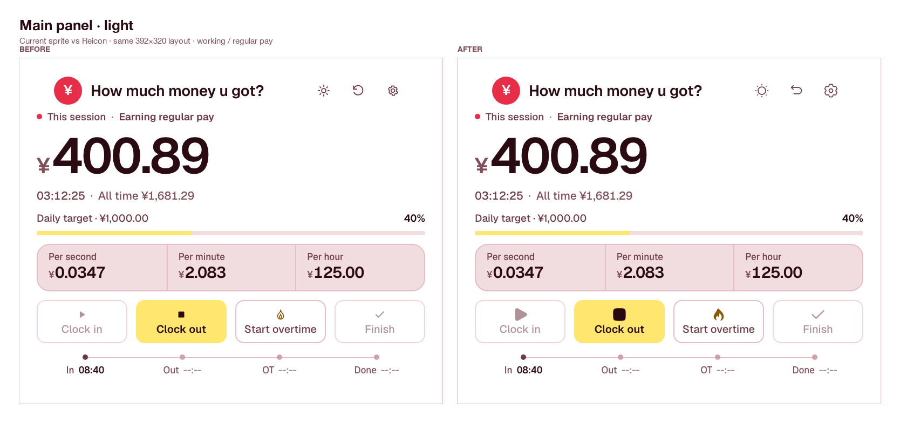

### 5.2 细节 · header / action row / pay card

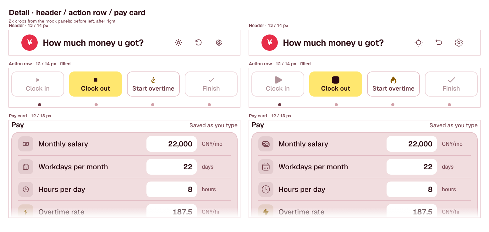

最明显的收益在第 2 行：`flame` 从细线变成实心，`check` 从发丝变成实心；`play` / `stop` / `flame` / `check` 四个按钮终于同一重量。截图里 `Finish` 是 disabled（`.action:disabled { opacity: .62 }`），所以看起来仍偏淡；启用时它是实心。第 1 行 header 只是略大一点，远看几乎不变。第 3 行 pay icons 从 12→13，钞票 / 日历 / 钟 / 闪电更清楚，但仍然是线稿（bolt 保持 Filled）。

### 5.3 设置页 · light（首屏 + 滚到底）

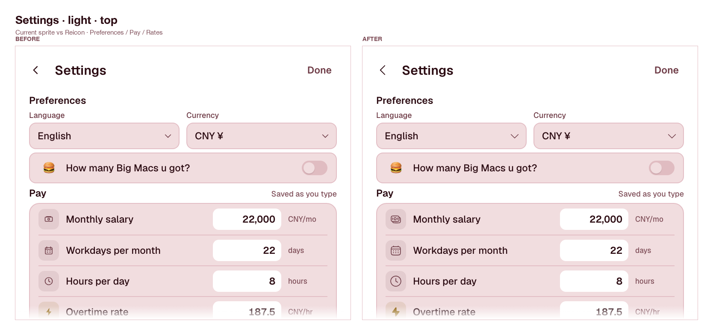

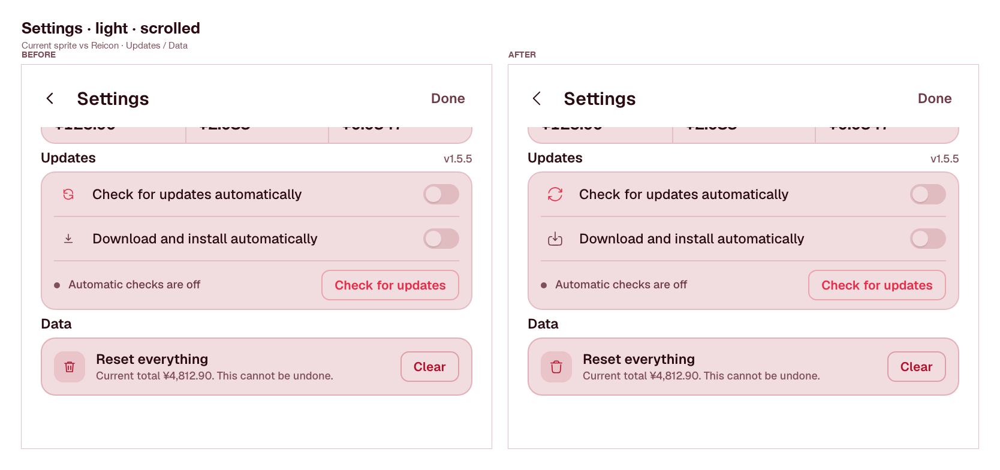

设置页的 diff 更小：back 15、两个 select chevron 12、四个 pay icon 13、update 的 `arrows-rotate` / `download` 13、trash 13。没有文字或行高变化。

### 5.4 主界面 · dark（zh-Hans）

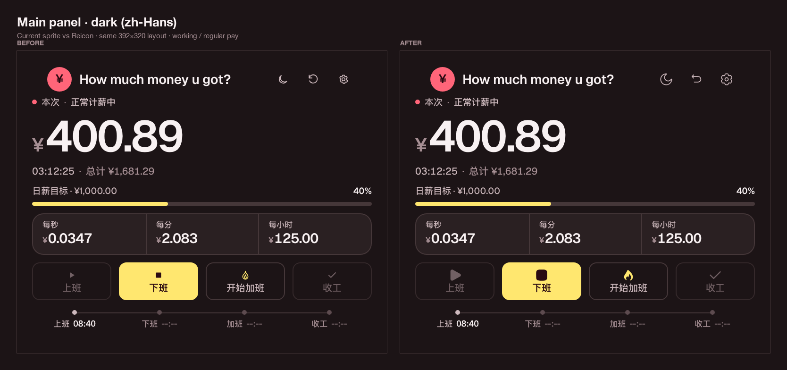

暗色下最明显的是 header 图标变大和 action flame/check 变实心；`Finish` 在截图里是 disabled，所以仍偏淡，启用时是实心。其余保持同一套 token。

### 5.5 图标矩阵

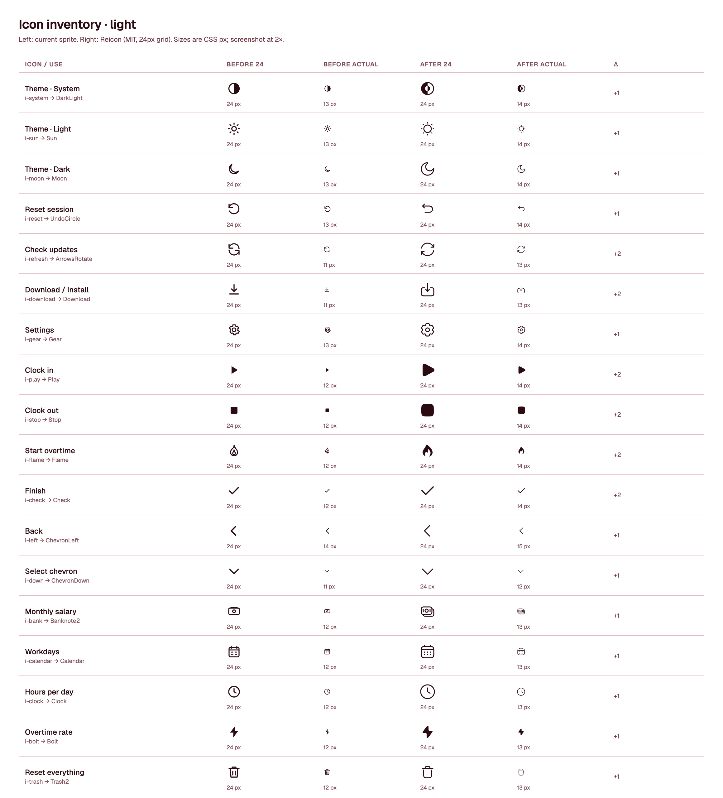

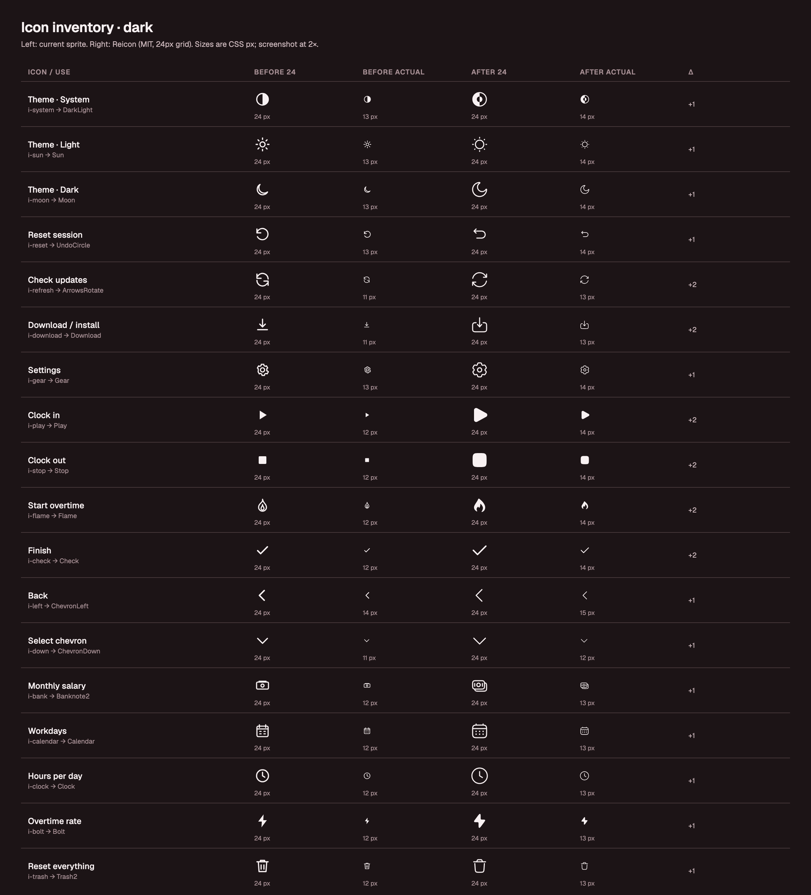

矩阵同时给出 24px 形状和“实际尺寸”两列，方便判断光学重量。可以看到：
- Reicon 在 24px 的字形比现有 sprite 更满（例如 gear、sun、play），所以不能按同一尺寸直接替换；
- 13→14 / 12→14 之后，实际尺寸才回到接近当前的重量；
- Outline 在 11–12px 确实偏细，Filled 在 12–14px 明显更稳。

### 5.6 像素 diff

| 画面 | 变化像素（阈值 >10） | 占比 | 变化区域 |
| --- | --- | --- | --- |
| Main · light | 2,015 / 501,760 | **0.40%** | header x553–703 y47–80；action x106–703 y~460–490 |
| Main · dark | 2,075 / 501,760 | **0.41%** | header x553–703 y47–80；action x106–703 y~460–490 |
| Settings · top | 1,483 / 501,760 | **0.30%** | back、两个 select chevron、四个 pay icon |
| Settings · scrolled | 882 / 501,760 | **0.18%** | back、update 两个 icon、trash |

结论：**没有结构 / 文案 / 行高变化**；main 的 diff 全部落在图标列，action 标签 0 变化。`Start overtime` / `Finish` 的基线通过 14px icon + `margin: -1px 0` 保持不变。

---

## 6. 建议

| 选项 | 内容 | 视觉收益 | 工作量 | 风险 | 双端一致 |
| --- | --- | --- | --- | --- | --- |
| **A（推荐）** | Electron 全量 18 图标 + 尺寸 + a11y 修复；SwiftUI 保留 SF Symbols | Windows 侧明显；macOS 不动 | 2–3h + QA | 低 | 否 |
| B | 双端全量 18 图标（Electron sprite + SwiftUI bundled SVG/PDF 或 Path） | 两端几何一致 | 1–1.5d + QA | 中：macOS 13 SVG、无障碍、资源管线 | 是 |
| C | 不换 Reicon；只修 action row（`flame.fill` / 更粗 check）+ 尺寸 + a11y | 主界面最大痛点被修 | 1–2h | 很低 | 否 |
| D | 保持现状 | 0 | 0 | 0 | 否 |

**我的判断：**
- 如果这次的目标是“Windows 版更清楚、图标更统一”，选 **A**。它是唯一能同时解决 F1 + F2 + F3 的低风险路径。
- 如果产品明确要求“两个平台看起来是同一套图标”，选 **B**；但要先接受 SwiftUI 的额外成本，并在 macOS 13 上验证 SVG/PDF。
- 如果只想用最小改动修主界面，选 **C**；它不引入依赖，但双端漂移和设置页的小图标问题还在。
- 无论选哪个，**F5 / F6 都建议顺手修**：它们和换不换图标无关，是当前真实的 a11y 缺口。

---

## 7. 如果批准：实施计划

> 以下是计划，本次没有执行。所有 `app` 源码保持原样。

### 7.1 Electron（Option A 的第一步）

1. **新增图标源**：把 18 个 Reicon SVG 放到 `Scripts/reicon/`（构建 / 审计用，不进 app bundle）或 `electron/src/renderer/icons/`，保留 24×24、currentColor；源文件只作生成用，运行时仍然是 index.html 里的内联 sprite。附一个 `manifest.json`：
   ```json
   { "id": "i-gear", "name": "gear", "weight": "Outline", "sizeBefore": 13, "sizeAfter": 14 }
   ```
2. **替换 sprite**：`electron/src/renderer/index.html:11–32` 的 `<defs>` 换成 18 个 `<symbol>`，保留现有 `i-*` id，其余 markup 不动。这样只有 sprite 和 CSS 变化，JS 不需要改。
3. **改尺寸**：`styles.css`：
   - `.iconbtn svg` 13→14
   - `.action svg` 12→14；加 `margin: -1px 0`（保持原有 `gap: 2px`）
   - `.backbtn svg` 14→15
   - `.select-shell svg` 11→12，`top: 10px`→`9.5px`
   - `.update-prompt svg` 12→13
   - `.update-row-icon svg` 11→13
   - `.picon svg` 12→13
   - `.dicon svg` 12→13
4. **a11y 顺手修**：
   - action `<svg>` 加 `aria-hidden="true" focusable="false"`；
   - 保留现有的本地化 `title`（不要因为换图标丢掉）；
   - 加共享 `:focus-visible`；
   - 把 `Current rates` / `Time clock` / `Session timeline` / `Language` / `Currency` / canvas label 加进 `i18n.js`。
5. **Notices**：根目录与 `electron/THIRD_PARTY_NOTICES.md` 各加一段 Reicon MIT（保留版权与许可文本）。
6. **不改**：`renderer.js` 的 action 状态逻辑、store、updater；i18n 只新增 section label 条目，不改已有文案。

### 7.2 SwiftUI（Option B，若批准）

1. **新增 `ReiconIcon`**：
   - 方案 1（推荐先验证）：把 18 个 SVG 字符串编译进 `ReiconAssets.swift`，`NSImage(data:)` 加载，`isTemplate = true`，`.resizable().frame(width:height:)`，`.foregroundStyle(tint)`，默认 `.accessibilityHidden(true)`。不改 `Package.swift`、不加资源 bundle。
   - 方案 2（macOS 13 风险更低）：提交 18 个 PDF（template rendering），放 `Sources/HowMuchApp/Icons/`，`Package.swift` 加 `.process("Icons")`，用 `Bundle.module` 加载。需要改 `Scripts/build_app.sh` 确保 resource bundle 进 .app。
2. **替换引用**：
   - `DashboardView.swift`：theme（`ThemePreference` 改成 `reiconName`）、reset、gear、play、stop、flame、check、update prompt。
   - `SettingsView.swift`：back、banknote、calendar、clock、bolt、refresh、download、trash、chevron.down。
   - `ActionTile` 增加 `iconWeight` 参数（actions 用 `.filled`）。
3. **a11y**：每个 `ReiconIcon` 默认 `accessibilityHidden(true)`；按钮已有 `.help` / `.accessibilityLabel`，不要重复朗读；保留 `.help`。
4. **验证**：`swift build` → `./Scripts/check.sh` → `./Scripts/build_app.sh` → 用 `--capture-overtime` 或手动截图对照 `docs/redesign/shots/app-*.png`；macOS 13 实机确认 `NSImage(data:)` / PDF 都能加载。
5. **回滚**：SwiftUI 改动集中在 `ReiconIcon.swift` + 3 个 view 文件；sprite 侧只在 `index.html` / `styles.css` / notices。回滚就是恢复这几个文件，不涉及数据或 store。

### 7.3 工具与 manifest

- 建议一个 `Scripts/reicon-manifest.json`，记录 18 个 `id / name / weight / size / platform`；生成脚本从 manifest 输出 Electron sprite 和 Swift `ReiconAssets.swift`。
- 生成脚本可以是一次性的（不参与 app 构建），但 manifest 要进版本控制；否则两端很容易再次漂移。
- **不要**把 `reicon` 加进 `electron/package.json` 的 dependencies：运行时不需要它，SVG 已经是静态资源；加依赖只会扩大安装包和供应链面。

### 7.4 工作量

| 部分 | 估计 | 说明 |
| --- | --- | --- |
| Electron sprite + CSS + a11y | 2–3h | 18 个 symbol + 8 条 CSS + 3 个 a11y 修复 |
| Electron QA | 1–2h | light/dark、en/zh、1×/1.25×/1.5×、keyboard |
| SwiftUI wrapper + 18 替换 | 5–7h | `ReiconIcon` + 18 个引用 + 资源/PDF 选择 |
| SwiftUI QA | 2–3h | build、capture、macOS 13 |
| Notices / manifest / docs | 1–2h | 一次性 |

---

## 8. 验证计划

### Electron

- `cd electron && npm test`（确认 core 不回归；图标改动本身靠截图 / 手动检查）。
- `npm start`；在 Windows 100% / 125% / 150% 缩放下截图，重点看 header 14px 和 action 14px 的描边/实心。
- Light / Dark × English / 简体中文 × working / overtime / finished；Settings 首屏 + 滚到底。
- 键盘 Tab 走一遍：theme / reset / settings / 四个 action / back / done / clear；确认 focus ring 可见且不被裁切。
- 屏幕阅读器（Narrator 或 VoiceOver）抽查：theme、reset、settings、actions、selects；确认中文界面不再混入英文 section label。
- 视觉回归：用相同的静态快照 diff，确认变化只在图标区域（本次基线：0.18–0.41%）。

### SwiftUI

- `swift build`；`./Scripts/check.sh`；`./Scripts/build_app.sh`。
- 打开 app，截 `app-main-*` / `app-settings-*` 同角度对比；重点看 14px action 在 2× Retina 上的实心效果。
- macOS 13 实机（或 VM）验证 `NSImage(data:)` 的 SVG 解码，或 PDF 资源加载；如果失败，切 PDF/Path 方案。
- Reduce Motion 下检查状态点 / 火焰；VoiceOver 抽查 action / settings 行。
- 确认 icon-only button 的 `.help` 仍然存在，自定义图片不会覆盖按钮 label。

### 发布

- 根目录 + Electron 的 third-party notices 都包含 Reicon MIT。
- 如果走 Option B，确认离线版仍然不发起任何网络请求（图标是静态资源，不应改变这一点）。
- App icon 没有变，不需要重跑 `Scripts/make_icon.py` / iconset。

---

## 9. 未验证 / 已知边界

1. **v1.6.0 已接入真实运行态**。第 5 节的 Before/After 仍是替换前的静态稿；真实的 Electron / SwiftUI 截图见第 11 节。实际 compositor 与静态稿可能有 <1px 差异，但真实截图已经确认没有布局问题。
2. **1× 只验证了 macOS 上的 Electron capture**。F2 的结论来自 CSS/数学和 macOS 1×/2× 截图；Windows 100% 物理屏仍未看过。若 1× 下 header 偏细，header 可以再升到 15，actions 已经 Filled 不受影响。
3. **macOS 13 实机未跑**。落地选了 PDF template image（macOS 原生矢量格式，不是 SVG），比 SVG 方案的风险低；但最低系统 13.0 的实机验证仍未做。本次在 macOS 26 上完成了构建、打包和真实截图。
4. **没有做真实屏幕阅读器测试**。F6 是代码层判断，实际读屏器行为可能不同（尤其 inline SVG 和 canvas）。
5. **没有改 app icon**。`docs/redesign/icon-candidates/` 里的 5 个方向仍是独立决策。
6. **Reicon 版本**：MCP 与 npm 1.2.5 的 path 对齐；如果未来升级，manifest 要重新核对，尤其是 `undo-circle` / `dark-light` 这种形状有差异的图标。
7. **SwiftUI 的 After 现在有真实截图**（第 11 节）；第 5 节的 After 仍是替换前的静态对比稿，两者不要混用。

**Verdict：landed in v1.6.0（Option A + a11y）。** 当前图标可用；Reicon 对 Electron 是低风险的一致性升级，对 SwiftUI 是需要更多验证、但已经落地的品牌统一。关键经验仍然是：不要在没做尺寸调整的情况下直接换 path，否则 UI 会更淡。

---

## 10. 文件与复现

```
docs/redesign/icon-refresh/
├── README.md                     ← 本文
├── panel-before.html             ← 当前 sprite / 当前尺寸的静态快照
├── panel-after.html              ← Reicon / 新尺寸的静态快照
├── mock.js                       ← 静态演示数据（不接 app / preload）
└── shots/
    ├── before-main-light.png / after-main-light.png
    ├── before-main-dark.png / after-main-dark.png
    ├── before-settings.png / after-settings.png
    ├── before-settings-scroll.png / after-settings-scroll.png
    ├── before-after-main-light.png
    ├── before-after-main-dark.png
    ├── before-after-settings-light.png
    ├── before-after-settings-scroll-light.png
    ├── detail-header-actions.png
    ├── icon-matrix-light.png
    ├── icon-matrix-dark.png
    ├── actual-macos-main-light.png
    ├── actual-macos-settings-light.png
    ├── actual-macos-main-dark.png
    ├── actual-electron-main-light.png
    ├── actual-electron-main-1x.png
    └── actual-electron-settings-scroll-light.png
```

打开方式：

```
# 在仓库根目录起一个本地静态服务器（或直接 file:// 打开）
python3 -m http.server 8765 --bind 127.0.0.1
# http://127.0.0.1:8765/docs/redesign/icon-refresh/panel-before.html?screen=main&theme=light&lang=en
# http://127.0.0.1:8765/docs/redesign/icon-refresh/panel-after.html?screen=main&theme=light&lang=en
# settings 滚到底：&screen=settings&scroll=1
```

快照依赖 `electron/src/renderer/styles.css` 和 `fonts/Geist.ttf`；如果之后改了 renderer CSS，需要重新跑截图。在 `docs/redesign/icon-refresh/` 下执行截图命令示例：

```
"/Applications/Google Chrome.app/Contents/MacOS/Google Chrome" \
  --headless=new --no-sandbox --disable-gpu --hide-scrollbars \
  --user-data-dir=/tmp/icon-refresh-chrome \
  --force-device-scale-factor=2 --window-size=392,320 --virtual-time-budget=2500 \
  --screenshot=shots/after-main-light.png \
  "file:///.../docs/redesign/icon-refresh/panel-after.html?screen=main&theme=light&lang=en"
```

**v1.6.0 实际改动的应用文件**：`electron/src/renderer/index.html`、`styles.css`、`renderer.js`、`electron/src/i18n.js`、`Sources/HowMuchApp/{DashboardView,SettingsView,Theme,ReiconIcon,UpdateController,FirePreview}.swift`、`Sources/HowMuchCore/AppMetadata.swift`、`Resources/Info.plist`、`Resources/Reicon/*.pdf`、`Scripts/build_app.sh`、`electron/package.json`、`electron/package-lock.json`、两份 `THIRD_PARTY_NOTICES.md`。App icon 仍未改。

---

## 11. v1.6.0 实施记录

2026-11-08 已按 **Option A + a11y 修复** 落地，版本号 **1.6.0**（macOS build 13）：

- **macOS SwiftUI**：新增 `ReiconIcon` + `Resources/Reicon/*.pdf`（18 个 24×24 pt template image），替换全部 18 个 SF Symbols；`Scripts/build_app.sh` 把 PDF 复制进 app bundle。
- **Electron**：`index.html` 的 18 个 `<symbol>` 换成 Reicon 原始 path；尺寸、Filled 权重、`margin: -1px 0`、focus ring、ARIA 本地化一并落地。
- **授权**：Reicon MIT 已加入根目录和 `electron/THIRD_PARTY_NOTICES.md`。

### 真实运行截图

macOS SwiftUI（2×，`--capture-mode normal/settings`）：

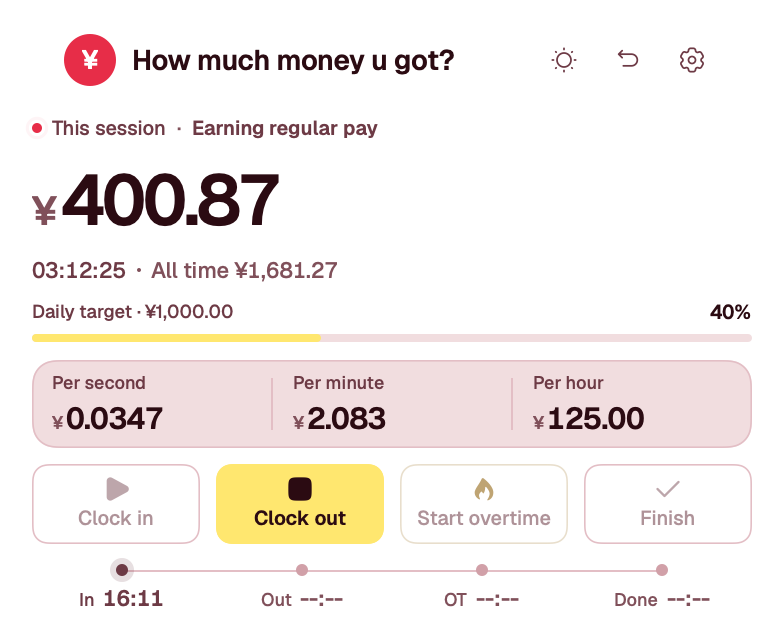

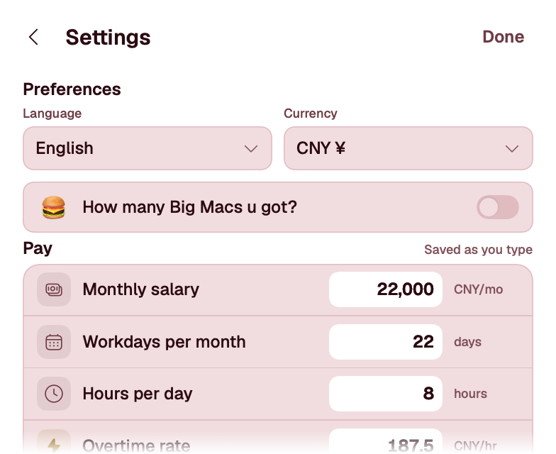

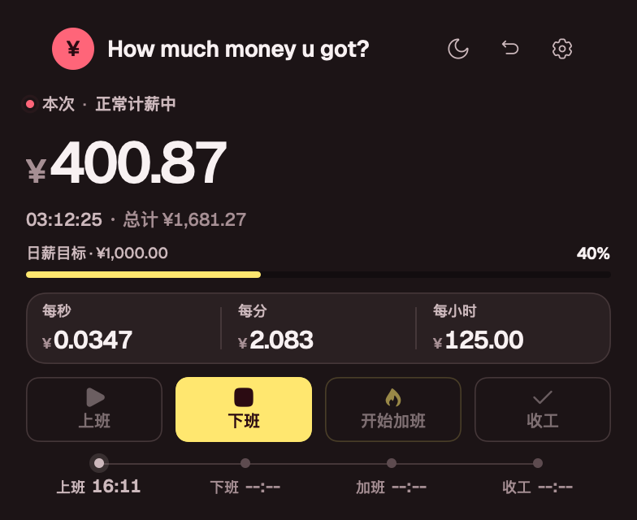

Windows Electron renderer 的真实 capture（在 macOS 上运行同一份 renderer；不是 Windows 截图）：

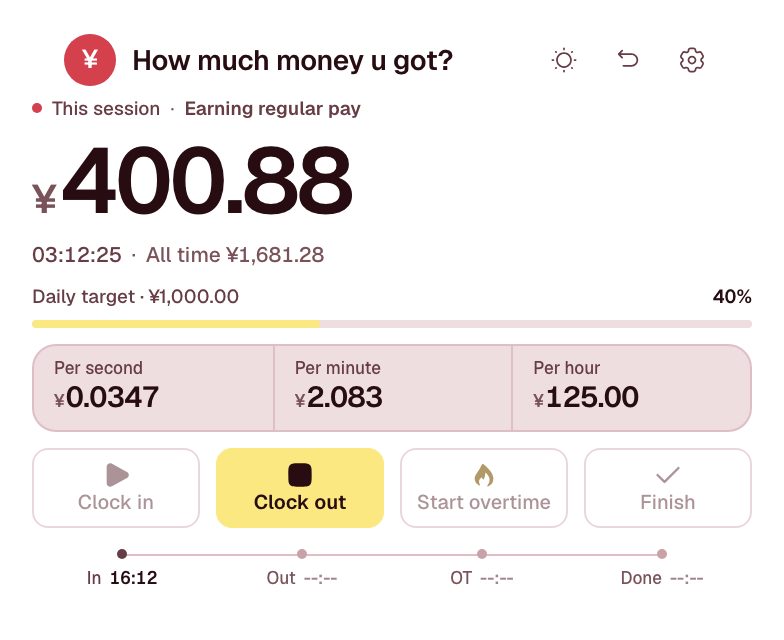

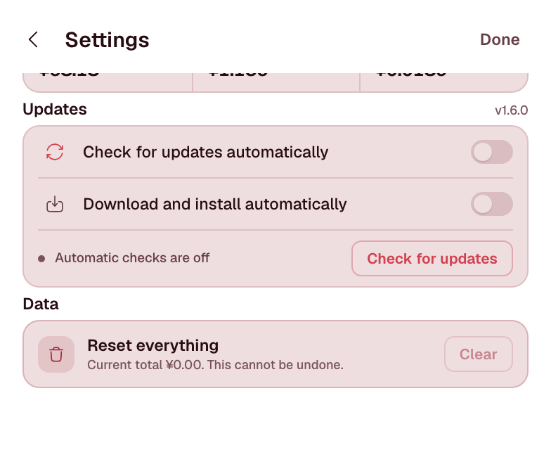

Electron 1× capture（392×320；用于检查亚像素效果）：


### 本地验证

- `swift build`、`Scripts/check.sh`、`Scripts/build_app.sh`、`HOWMUCH_OFFLINE=1 Scripts/build_app.sh`、`Scripts/build_universal_app.sh`（x86_64 + arm64）通过。
- Electron：`npm test` 10/10 通过；真实 `--capture` 的 main / settings / dark / 1× 都正常。
- 版本：`1.6.0`；macOS build `13`；Settings 更新卡片显示 `v1.6.0`。
- 仍未验证：Windows 100% 物理屏、macOS 13 实机、真实屏幕阅读器。发布由 `.github/workflows/electron-release.yml` 的 tag build 完成。
